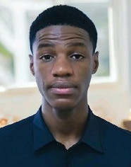

```text
ice@icesys ──────────────────────────────────────────────── 
. Role:          Electronics & Embedded Systems Engineer
. Focus:         Embedded Systems, Microcontrollers, PCB design, robotics

- Languages ───────────────────────────────────────────────
. Programming:   C/C++, MicroPython
. Spoken:        English, French

- Embedded ────────────────────────────────────────────────
. MCUs:          ESP32, Arduino
. Framework:     PlatformIO
. Practice:      Firmware development, peripheral interfacing

- Hardware Design ─────────────────────────────────────────
. PCB / EDA:     KiCad, Altium Designer
. Assembly:      8085 (GNUSim8085)
. Simulation:    Proteus, GNU Octave
. Mechanical:    FreeCAD

- Tooling ─────────────────────────────────────────────────
. Dev:           VS Code, Git, GitHub, Linux (Arch)

- Projects ────────────────────────────────────────────────
. fire_patrol_autonomous_robot     C++
. smart attendance system          C++
```

<p align="center">
  
  
  
</p>
